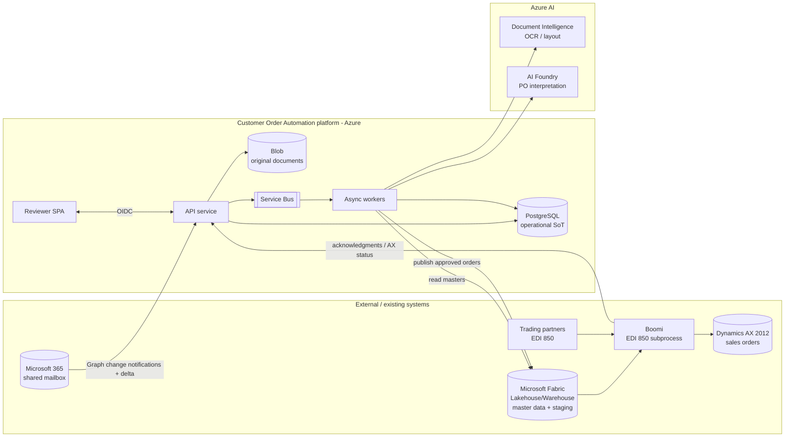
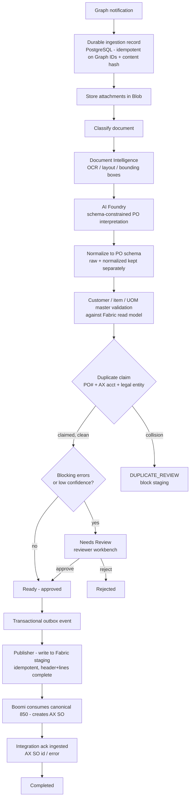

# 01 — Target Architecture & Data Flow

Covers spec §2 (architecture/data flow) and §15 (infrastructure/operations). Diagrams are Mermaid so
they render in GitHub / VS Code without external tooling.

## 1.1 System context



## 1.2 End-to-end processing flow (the "happy path" + review branch)



**Key rule encoded above:** duplicate reservation happens **before** staging, and AI confidence never
bypasses a blocking validation check (§7 "AI confidence never bypasses blocking checks").

## 1.3 Status model (§9)

Simple (user-facing) statuses map onto granular internal states:

| Simple status | Internal states (examples) |
|---|---|
| Received | `INGESTED` |
| Processing | `OCR_PENDING`, `OCR_DONE`, `AI_PENDING`, `VALIDATING` |
| Needs Review | `NEEDS_REVIEW`, `DUPLICATE_REVIEW` |
| Ready | `READY`, `STAGED` |
| Sent to ERP | `BOOMI_CLAIMED`, `ERP_CREATING` |
| Completed | `ERP_CREATED` |
| Failed | `FAILED` (+ failure reason / dead-letter ref) |
| Rejected | `REJECTED` |

## 1.4 Component responsibilities

| Component | Responsibility | Must NOT |
|---|---|---|
| **API service** | OIDC auth, reviewer/admin REST, Graph webhook receiver + validation, enqueue jobs, serve documents/evidence | hold long-running work; be the source of workflow truth for email state |
| **Workers** | OCR, AI interpretation, validation, duplicate claim, publishing, reconciliation sweepers | write directly to AX; bypass the outbox |
| **SQL database in Fabric** (ADR 0007; was PostgreSQL) | operational source of truth: orders, validation, jobs, audit, duplicate claims, outbox, learning store | hold reference master data as authority; be left on pausable/throttled capacity |
| **Fabric** | authoritative read of customer/item masters; staging destination for approved orders | be assumed transactional — see §11 constraint |
| **Blob** | immutable original documents + raw OCR payloads under retention | — |
| **Service Bus** | durable work queues, dead-letter, retry/backoff | — |
| **Boomi** | canonical 850 transform + AX sales-order creation + retries/error handling | be disrupted for existing EDI traffic |

## 1.5 Separation-of-concerns invariant (§2)

```
AI suggests  ─────►  deterministic rules authorize  ─────►  PostgreSQL claim guarantees uniqueness
(DI + Foundry)       (validation policy, thresholds)        (atomic, cross-channel coordinated)
```

Reference data flows **in** from Fabric (read-only). Approved orders flow **out** to Fabric staging
(controlled Delta write path — see `07-contract-questions.md` Q-FAB-2). The platform never writes to
AX directly.

## 1.6 Deployment topology (§15)

- Separate **dev / test / prod** resource groups and identity boundaries.
- Azure **Container Apps** host three independently scalable apps: `web`, `api`, `workers`.
- Managed identities first; private endpoints where supported; Terraform modules with parameterized
  environments.
- Full Azure resource inventory in `06-azure-resources.md`.
