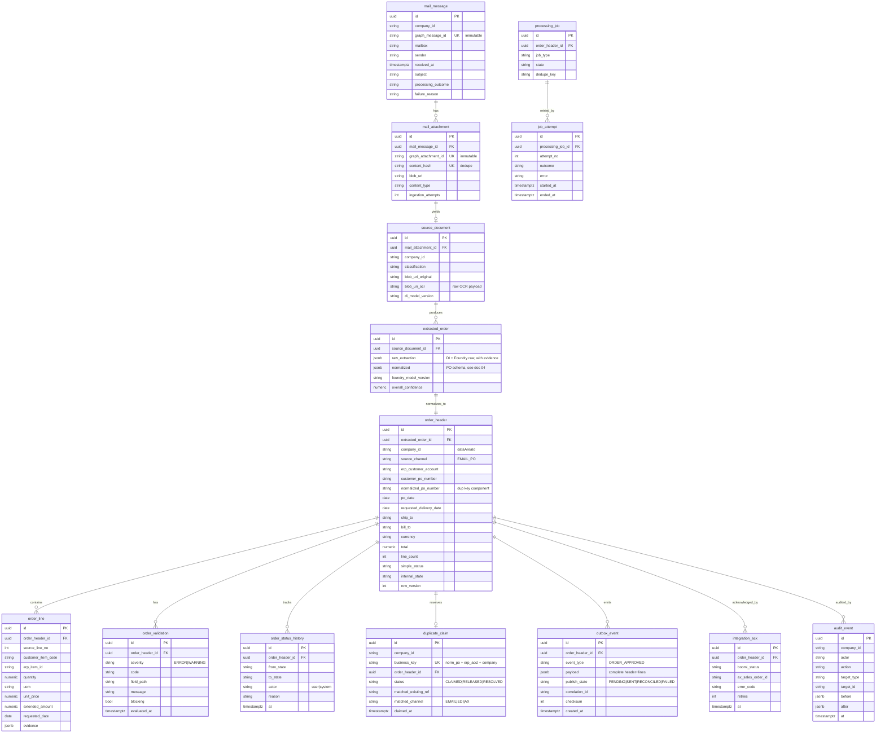
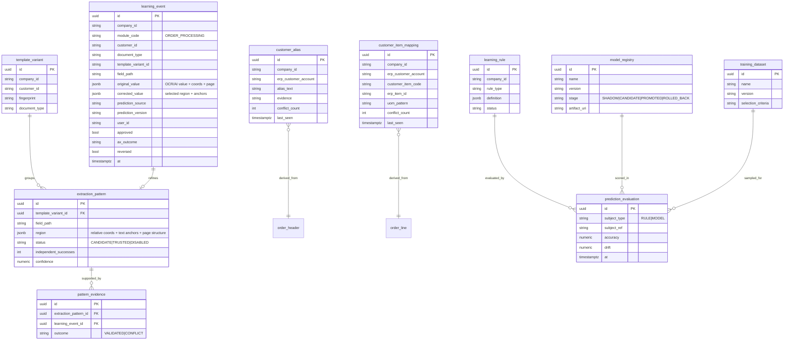

# 03 — Operational Data Model (ERD)

> **Engine update (ADR 0007):** the operational store is a **SQL database in Fabric** (T-SQL / SQL
> Server engine), superseding ADR 0001's PostgreSQL. The entities and keys below are unchanged; the
> physical DDL is T-SQL in `db/migrations/` (e.g. `jsonb`→`nvarchar(max)`+`ISJSON`, partial unique
> index→filtered unique index). Read "PostgreSQL" below as "the operational store."

Covers spec §12. The operational store is the source of truth. All internal IDs are UUIDs; every row
carries `company_id` (legal entity / `dataAreaId`), `source_channel`, row-version/concurrency fields,
and created/updated timestamps. Indices on customer/PO/company and on queue/status columns.

Two bounded contexts share the DB: **Operational** (ingestion → publish) and **Learning** (§10).

## 3.1 Operational entities

### Consistency & keys (§12)
- **Business/duplicate key** = `normalized_po_number + erp_customer_account + company_id`, enforced by a
  **unique partial index** on `duplicate_claim(business_key) WHERE status IN ('CLAIMED','RESOLVED')`.
  This is the atomic cross-worker guarantee (§8).
- **Immutable document hashes** (`mail_attachment.content_hash`) + immutable Graph identifiers give
  ingestion idempotency (§4): a replayed webhook / re-scan / retry cannot create a second business order.
- **Optimistic concurrency** via `order_header.row_version` protects reviewer edits (§13).
- **Outbox** decouples approval from Fabric publish; publisher is retryable + reconciled (§11).

## 3.2 Learning entities (§10, §12)

### Learning guardrails encoded in the model (§10)
- `module_code` on every learning row → **no cross-module contamination**; module-scoped but **not** a
  tenant model.
- First correction → `extraction_pattern.status = CANDIDATE`. Promotion to `TRUSTED` requires
  `independent_successes >= configurable_threshold` **and** master-data revalidation — "no guarantee
  from count alone."
- `customer_alias` / `customer_item_mapping` carry `conflict_count` + recency so **stale learned
  mappings cannot bypass Fabric master validation.**
- `model_registry.stage` supports shadow mode → controlled promotion → rollback (§10 roadmap).
