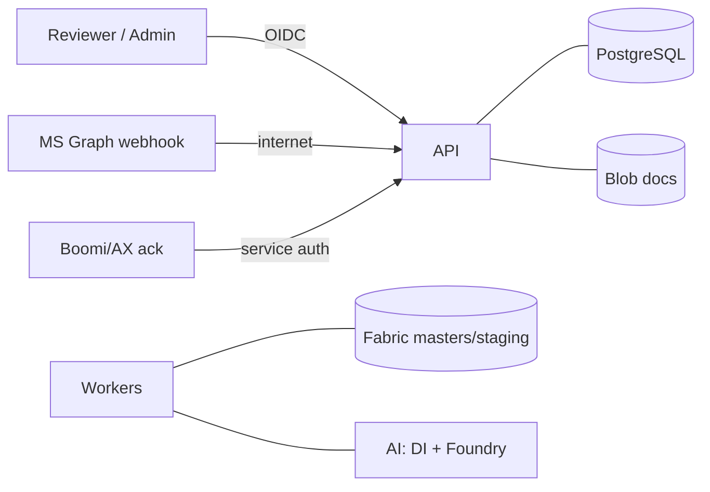

# 08 — Threat Model (STRIDE)

Covers spec §3 (identity/access/security) plus the security-relevant controls in §4, §8, §11, §15.
Scope: the Azure-hosted platform and its trust boundaries with Graph, Fabric, Boomi/AX, and reviewers.
This is a living document; finalize after Q-ENV-1 (security standards) and Q-GRAPH-1.

## 8.1 Trust boundaries & assets

**Primary assets:** customer PO documents (PII), master data read access, the duplicate-claim integrity,
staging write capability (path to AX), secrets/managed identities, audit trail, learning corrections.

## 8.2 STRIDE analysis

### Spoofing
| Threat | Control |
|---|---|
| Forged Graph webhook triggers fake ingestion | Validate subscription `clientState` + validation-token handshake; verify notification authenticity; reconcile against Graph **delta query** so spoofed events can't invent orders (§4). |
| Caller impersonates Boomi on `/integration/acknowledgments` | Dedicated **Integration Service** app role via Entra service auth; mTLS/IP allow-list if available (Q-BOOMI-2). |
| Reviewer impersonation | Entra OIDC; short-lived tokens; roles enforced server-side per action (§3). |

### Tampering
| Threat | Control |
|---|---|
| Alter order after approval to change what reaches AX | Transactional **outbox** publishes only complete validated header+lines; line-count/checksum reconciliation; stable idempotent writes (§11). |
| Malicious attachment (malware/polyglot) | **Malware screening** + content-type validation before processing (§3); quarantine on fail. |
| Learned pattern poisoned to mis-extract | Patterns start CANDIDATE; promotion needs independent validated successes **and** master-data revalidation; kill-switch via `/learning/patterns/{id}/disable` (§10). |
| Tampering with master data assumptions | Fabric is **read-only** reference; stale/missing treated as controlled exception (§6). |

### Repudiation
| Threat | Control |
|---|---|
| User denies making a correction/approval | Immutable `audit_event` + `order_status_history` with actor, before/after, correlation IDs; auditable admin changes (§3, §12). |
| Dispute over what the document said | Original document + raw OCR preserved immutably in Blob under retention (§5). |

### Information disclosure
| Threat | Control |
|---|---|
| PII leakage in logs | **PII redaction in logs**; never log raw secrets; secret-scrubbing at Monitor ingestion (§3, §15). |
| Over-broad mailbox access | Narrowly scoped Graph **application permissions** + Exchange application-access scoping (§3, Q-GRAPH-1). |
| Document exfiltration via direct Blob access | Private endpoints; access via API with SAS-scoped/proxied `GET /orders/{id}/document`; RBAC. |
| Secrets in code/state/migrations | Managed identity first; secrets only in Key Vault; seeds carry **no** secrets; `.gitignore` blocks env/state (§3, §12). |

### Denial of service
| Threat | Control |
|---|---|
| Graph throttling / notification storm | Rate limiting, retries with backoff, subscription renewal, delta reconciliation (§4, §16 test cases). |
| Poison message stalls a queue | DLQ + poison-message quarantine + stuck-job sweeper (§15). |
| Expensive AI calls drive cost/DoS | Timeouts, retries, rate limits, **usage/cost tracking** on Foundry (§5); per-principal API rate limits. |
| Downstream (Fabric/Boomi/AX) unavailable | Outbox + retryable publisher + reconciliation; Boomi-ack **timeout alert**; graceful `Failed` with re-drive (§11, §16). |

### Elevation of privilege
| Threat | Control |
|---|---|
| Viewer performs Processor/Supervisor actions | Deny-by-default; role checked **per action** not just per route (§3, §13). |
| Supervisor override abused to force a duplicate through | Override permitted **only under explicit policy**, fully audited, original claim history retained (§8). |
| Worker identity over-privileged | User-assigned managed identities with least-privilege role assignments per resource (§3). |
| Dev environment reaching production | Separate RGs/identity boundaries; **no production ERP writes / mailbox changes in dev**; mocks test-env only (§3, §15, §18). |

## 8.3 Cross-channel duplicate integrity (dedicated — it is the #1 acceptance gate)

> "No invalid/duplicate order reaches AX" (§16). Threats specifically against the claim:

- **Concurrent email workers** claim same PO → PostgreSQL **unique reservation** (partial unique index)
  makes exactly one win; losers route to `DUPLICATE_REVIEW`.
- **Email↔EDI race** (same order arrives both channels) → claim must be coordinated with Boomi/AX
  idempotency (Q-BOOMI-3, Q-AX-1); check *both* `email→EDI` and `EDI→email` collision paths (§8).
- **Claim released incorrectly** → releases audited; resolution only via policy-gated supervisor action.

## 8.4 Open items feeding the final model
Q-GRAPH-1 (app-access scoping), Q-ENV-1 (networking/WAF, residency, retention, RPO/RTO),
Q-BOOMI-2/3 + Q-AX-1 (cross-channel idempotency). Until closed, treat the staging→Boomi boundary as the
highest-risk surface.
